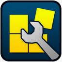

<a id="readme-top"></a>

<!--
SASM macOS ARM64 Port

SASM itself is Copyright (C) 2013 Dmitriy Manushin and is distributed
under the GNU General Public License v3.0 or later.
-->

<br />

<div align="center">
  <a href="https://github.com/riniwtz/SASM-macOS-arm64-port">
    
  </a>

  <h3 align="center">SASM macOS ARM64 Port</h3>

  <p align="center">
    An unofficial, reproducible macOS Apple Silicon port of SASM 3.16.0.
    <br />
    Built with Qt 5, qmake, macdeployqt, Mach-O tooling, and macOS code signing.
    <br />
    <br />
    <a href="https://github.com/Dman95/SASM"><strong>View upstream SASM »</strong></a>
    <br />
    <br />
    <a href="https://github.com/riniwtz/SASM-macOS-arm64-port/releases">Releases</a>
    &middot;
    <a href="https://github.com/riniwtz/SASM-macOS-arm64-port/issues">Report Bug</a>
    &middot;
    <a href="https://github.com/riniwtz/SASM-macOS-arm64-port/issues">Request Feature</a>
  </p>
</div>

---

## Table of Contents

<details>
  <summary>Expand</summary>

  <ol>
    <li><a href="#about-the-project">About The Project</a></li>
    <li><a href="#project-structure">Project Structure</a></li>
    <li><a href="#built-with">Built With</a></li>
    <li><a href="#download-and-install">Download and Install</a></li>
    <li>
      <a href="#getting-started">Getting Started</a>
      <ul>
        <li><a href="#prerequisites">Prerequisites</a></li>
        <li><a href="#clone">Clone</a></li>
      </ul>
    </li>
    <li><a href="#build">Build</a></li>
    <li><a href="#deploy">Deploy</a></li>
    <li><a href="#package">Package</a></li>
    <li><a href="#macos-specific-changes">macOS-Specific Changes</a></li>
    <li><a href="#running-nasm-code-on-macos">Running NASM Code on macOS</a></li>
    <li><a href="#debugging-with-lldb">Debugging with LLDB</a></li>
    <li><a href="#releases">Releases</a></li>
    <li><a href="#status">Status</a></li>
    <li><a href="#contributing">Contributing</a></li>
    <li><a href="#upstream">Upstream</a></li>
    <li><a href="#license">License</a></li>
    <li><a href="#acknowledgments">Acknowledgments</a></li>
  </ol>

</details>

---

## About The Project

SASM is a cross-platform IDE for assembly development supporting assemblers such as NASM, GAS, FASM, and MASM.

Upstream SASM provides official Windows and Linux support, but does not currently ship an official modern macOS application bundle.

This repository provides an **unofficial macOS ARM64 port and reproducible build workflow for SASM 3.16.0**.

The goal is not to turn SASM into a separate product, but to make the upstream source practical to build, deploy, archive, and distribute on Apple Silicon Macs.

### What this port adds

- Native Apple Silicon (`arm64`) SASM build
- Qt 5 / qmake macOS build workflow
- Proper macOS `.app` bundle generation
- Proper macOS `.icns` application icon
- Fix for the upstream Windows `RC_FILE = icon.rc` configuration affecting macOS bundle metadata
- Qt framework deployment with `macdeployqt`
- Ad-hoc macOS code signing after deployment
- Reproducible build, deploy, and package scripts
- ZIP release packaging suitable for GitHub Releases
- Bundled SASM includes, I/O helper source, keyboard shortcuts, and macOS examples
- Finder-compatible Homebrew NASM discovery
- Mach-O x86-64 NASM and Clang defaults, with migration of older Linux settings
- LLDB debugging through Apple Command Line Tools
- Preserved upstream SASM source and licensing information

### Tested environment

This port has been tested with:

- **SASM:** 3.16.0
- **Architecture:** Apple Silicon ARM64
- **macOS:** 27.0 (Apple Silicon)
- **Qt:** Qt 5.15.19
- **Build system:** qmake + make
- **Assembler:** NASM 3.02
- **Intel execution:** Rosetta 2
- **Linker:** Apple Clang
- **Deployment:** macdeployqt
- **Signing:** ad-hoc `codesign`

> [!NOTE]
> This project is an unofficial community port. It is not an official macOS release from the upstream SASM maintainer.

<p align="right">(<a href="#readme-top">back to top</a>)</p>

---

## Project Structure

```text
SASM-macOS-arm64-port/
├── .gitignore
├── LICENSE
├── README.md
├── versions.env
│
├── assets/
│   ├── sasm.icns
│   └── sasm.png
│
├── scripts/
│   ├── build.sh
│   ├── deploy.sh
│   └── package.sh
│
├── source/
│   └── src/
│       └── sasm/
│           └── BUILD/
│               ├── SASM.pro
│               ├── ...
│               └── build-macos/       # generated, gitignored
│                   └── sasm.app
│
├── upstream/
│   └── sasm_3.16.0-1.tar.gz
│
└── dist/                               # generated, gitignored
    └── SASM-3.16.0-macOS-arm64.zip
```

The `build-macos/` and `dist/` directories contain generated output and should not be committed to Git.

<p align="right">(<a href="#readme-top">back to top</a>)</p>

---

## Built With

- **SASM 3.16.0**
- **Qt 5**
- **qmake**
- **GNU Make**
- **Apple Clang**
- **NASM**
- **macdeployqt**
- **macOS codesign**
- **Shell scripts**

<p align="right">(<a href="#readme-top">back to top</a>)</p>

---

## Download and Install

If you only want to use SASM, download the latest prebuilt application:

**[Download SASM 3.16.0 for macOS ARM64](https://github.com/riniwtz/SASM-macOS-arm64-port/releases/latest/download/SASM-3.16.0-macOS-arm64.zip)**

1. Download the ZIP file.
2. Double-click it to extract `sasm.app`.
3. Drag `sasm.app` to your `Applications` folder.
4. The build is ad-hoc signed but not notarized. On first launch, Control-click
   `sasm.app` and choose **Open**, or allow it under **System Settings → Privacy
   & Security → Open Anyway**.
5. To build and run the included Intel x86-64 examples, install Rosetta when
   macOS prompts, or run:

   ```sh
   softwareupdate --install-rosetta
   ```

The application runs natively on Apple Silicon. Assembly programs target Intel
x86-64 and require Rosetta 2. NASM is not bundled; install it with
`brew install nasm`, or configure an explicit assembler path in SASM's settings.

<p align="right">(<a href="#readme-top">back to top</a>)</p>

---

## Getting Started

### Prerequisites

This port is intended for Apple Silicon Macs.

Confirm your architecture:

```sh
uname -m
```

Expected output:

```text
arm64
```

Install Apple's Command Line Tools:

```sh
xcode-select --install
```

Install Qt 5 and NASM with Homebrew:

```sh
brew install qt@5 nasm
```

Verify the Qt 5 qmake binary:

```sh
"$(brew --prefix qt@5)/bin/qmake" -v
```

Verify NASM:

```sh
nasm -v
```

### Clone

Clone the repository:

```sh
git clone https://github.com/riniwtz/SASM-macOS-arm64-port.git
cd SASM-macOS-arm64-port
```

Make the scripts executable if necessary:

```sh
chmod +x scripts/build.sh scripts/deploy.sh scripts/package.sh
```

<p align="right">(<a href="#readme-top">back to top</a>)</p>

---

## Build

Build SASM:

```sh
./scripts/build.sh
```

The generated application should be located at:

```text
source/src/sasm/BUILD/build-macos/sasm.app
```

The build script:

1. Copies the canonical macOS icon from `assets/sasm.icns`
2. Creates a separate, incremental macOS build directory
3. Runs Qt 5 `qmake`
4. Compiles SASM with `make`

The build output is intentionally kept separate from the preserved upstream source files.

<p align="right">(<a href="#readme-top">back to top</a>)</p>

---

## Deploy

Deploy the Qt frameworks and sign the final application bundle:

```sh
./scripts/deploy.sh
```

The deployment process is:

```text
sasm.app
   ↓
macdeployqt
   ↓
Qt frameworks embedded into the application bundle
   ↓
codesign
   ↓
signature verification
```

### Why signing happens after macdeployqt

`macdeployqt` copies and modifies Mach-O binaries and framework paths inside the application bundle.

Signing the application before deployment can invalidate the signature after those files are modified.

This may cause macOS to terminate SASM with an error such as:

```text
Namespace CODESIGNING
Code 2, Invalid Page
```

The final application bundle must therefore be signed **after** `macdeployqt` and after any other modification to executable code or bundled frameworks.

<p align="right">(<a href="#readme-top">back to top</a>)</p>

---

## Package

Create the distributable ZIP archive:

```sh
./scripts/package.sh
```

Output:

```text
dist/SASM-3.16.0-macOS-arm64.zip
```

The packaging script uses macOS `ditto` to preserve application bundle metadata:

```sh
ditto \
    -c \
    -k \
    --sequesterRsrc \
    --keepParent \
    sasm.app \
    SASM-3.16.0-macOS-arm64.zip
```

The ZIP archive is intended to be attached to a GitHub Release rather than committed directly into the repository.

<p align="right">(<a href="#readme-top">back to top</a>)</p>

---

## macOS-Specific Changes

### Application icon

Upstream SASM includes application artwork, but its qmake configuration contains a Windows resource entry:

```qmake
RC_FILE = icon.rc
```

When used during the macOS build, this can produce incorrect application bundle metadata such as:

```text
CFBundleIconFile = icon.rc
```

`icon.rc` is a Windows resource script and cannot be used as a native macOS application icon.

This port scopes the Windows resource configuration to Windows and provides a native macOS `.icns` file:

```qmake
win32 {
    RC_FILE = icon.rc
}

macx {
    ICON = sasm.icns
}
```

The resulting macOS bundle contains:

```text
sasm.app/
└── Contents/
    ├── Info.plist
    ├── MacOS/
    │   └── sasm
    └── Resources/
        └── sasm.icns
```

The resulting `Info.plist` references:

```text
CFBundleIconFile = sasm.icns
```

### Qt deployment

Qt libraries are embedded using:

```sh
"$(brew --prefix qt@5)/bin/macdeployqt" sasm.app
```

This allows the application to use the required Qt frameworks from inside its own `.app` bundle instead of relying on a Qt installation at runtime.

### Code signing

The final application is currently ad-hoc signed:

```sh
codesign \
    --force \
    --deep \
    --sign - \
    --timestamp=none \
    sasm.app
```

The resulting bundle is verified with:

```sh
codesign \
    --verify \
    --deep \
    --strict \
    --verbose=4 \
    sasm.app
```

> [!IMPORTANT]
> Ad-hoc signing is not the same as Apple Developer ID signing or Apple notarization.
>
> Release artifacts downloaded from GitHub may still trigger normal macOS Gatekeeper warnings on another Mac.

<p align="right">(<a href="#readme-top">back to top</a>)</p>

---

## Running NASM Code on macOS

Linux-oriented NASM workflows commonly generate ELF object files.

macOS uses the Mach-O object format instead.

For x86-64 NASM source intended to link through Apple Clang, assemble using:

```sh
nasm -f macho64 --pragma "macho build_version macos,11,0" program.asm -o program.o
```

Then link:

```sh
clang -arch x86_64 program.o -o program
```

The assembly source must expose an entry point compatible with the selected linking method.

For example, when linking through the normal C runtime with Clang, a minimal program can expose `_main`:

```asm
global _main

section .text

_main:
    mov eax, 42
    ret
```

Build it with:

```sh
nasm -f macho64 --pragma "macho build_version macos,11,0" program.asm -o program.o
clang -arch x86_64 program.o -o program
```

Then run:

```sh
./program
echo $?
```

Expected result:

```text
42
```

SASM now configures these tools automatically. New installations use NASM, x64,
Mach-O objects with DWARF information and macOS platform metadata, and
`/usr/bin/clang -arch x86_64`. The platform metadata prevents Apple's linker
from warning that the object has no platform load command.
SASM searches PATH and the Homebrew locations `/opt/homebrew/bin` and
`/usr/local/bin`, including when launched from Finder. Explicit paths in Settings
continue to take precedence.

SASM supports `main`, `CMAIN`, and `_main` through its bundled `macos.inc`
preinclude. The `io64.inc` library supports macOS C symbol names, relative
addressing, and the SysV variadic calling convention. Use `io64.inc` for 64-bit
programs; `io.inc` remains the upstream 32-bit library.

For a first test, open the bundled `Projects/Hello.asm` or `Projects/Sum.asm`
under `sasm.app/Contents/Resources/sasm`. For Sum, enter `20 22` in the Input
pane, then Build and Run. The expected output is `42`. Bundled examples open
as unsaved templates, so editing or building them does not modify the signed app.
Save a copy in your Documents folder to keep your changes.

On the first launch of this version, SASM replaces saved Linux/32-bit build
options with macOS defaults. The previous toolchain settings are retained under
`macos/previous` in SASM's preferences. Custom Mach-O settings are preserved.

The GAS option uses Apple's Clang assembler in x86-64 AT&T syntax. Use `_main`
for its entry point. FASM, MASM, and 32-bit mode are unavailable in this macOS
build. Linux system calls, ELF-specific directives, and Windows APIs need source
changes; changing the object format alone cannot port those programs.

> [!NOTE]
> The SASM application itself is built as native ARM64.
>
> NASM generates Intel x86-64 code, not ARM64 code. Running or debugging that
> code on Apple Silicon requires Apple's Intel translation support. If execution
> reports “Bad CPU type in executable”, enable/install Rosetta as described by
> [Apple](https://support.apple.com/102527). SASM does not install it automatically.

<p align="right">(<a href="#readme-top">back to top</a>)</p>

---

## Debugging with LLDB

The macOS build uses the LLDB supplied with Apple's Command Line Tools (`xcrun
lldb`). GDB and GDB signing certificates are not required. Debug, Continue/Pause,
Step Into, Step Over, source breakpoints, register inspection, and typed memory
watches use this backend. The debugger command field accepts LLDB commands;
`p expression` is also accepted.

Debugging uses DWARF line information. NASM macros may span several instructions,
so instruction stepping can remain on the same source line. The backend does not
insert frame-pointer instructions into your code. macOS may request developer
tool permission when starting a debugger.

Implementation references: [NASM Mach-O support](https://www.nasm.us/doc/nasm09.html)
and the [LLDB Python API](https://lldb.llvm.org/python_api.html).

## Verification

Run the app integration tests with:

```sh
./scripts/test.sh
```

The tests use isolated preferences and temporary directories, including paths
with spaces, and a Finder-like PATH without Homebrew. They cover new documents,
NASM and GAS builds, bundled I/O examples, settings migration, missing tools,
syntax errors, object-only builds, and the actual Build/Run actions with Hello
and Sum programs. Runtime tests explicitly skip when Intel
execution is unavailable. To require runtime tests to pass:

```sh
SASM_REQUIRE_EXECUTION=1 ./scripts/test.sh
```

Test the LLDB transport (requires permission to launch debuggee processes):

```sh
python3 scripts/test-debugger.py
# Also exercise Intel debugging when translation support is available:
python3 scripts/test-debugger.py --intel --nasm
```

The Intel debugger tests also exercise a NASM program with `io64.inc`, including
source breakpoints, instruction stepping, registers, memory, and input/output.
Source paths are matched to the debug information so macOS symlinks such as
`/var` and `/private/var` do not prevent breakpoints from resolving.

To use a non-Homebrew Qt 5.15 installation, set `QMAKE=/path/to/qmake` for the
build/test scripts and `QT_BIN=/path/to/qt/bin` for deployment.

<p align="right">(<a href="#readme-top">back to top</a>)</p>

---

## Releases

Release artifacts are generated from the reproducible scripts:

```sh
./scripts/build.sh
./scripts/deploy.sh
./scripts/package.sh
```

This produces:

```text
dist/SASM-3.16.0-macOS-arm64.zip
```

Create a release tag:

```sh
git tag -a v3.16.0-macos.2 \
    -m "SASM 3.16.0 macOS ARM64 release"

git push origin v3.16.0-macos.2
```

Create the GitHub Release using GitHub CLI:

```sh
gh release create v3.16.0-macos.2 \
    dist/SASM-3.16.0-macOS-arm64.zip \
    --title "SASM 3.16.0 macOS ARM64 Port" \
    --notes "Unofficial macOS ARM64 port of SASM 3.16.0."
```

<p align="right">(<a href="#readme-top">back to top</a>)</p>

---

## Status

SASM 3.16.0 successfully builds, deploys, signs, and packages on Apple Silicon macOS.

The current port includes:

- [x] Native Apple Silicon build
- [x] Valid macOS `.app` bundle
- [x] Qt 5 deployment with `macdeployqt`
- [x] Native `.icns` application icon
- [x] Correct macOS bundle icon metadata
- [x] Reproducible build script
- [x] Deployment and code-signing script
- [x] ZIP release packaging
- [x] Bundled runtime support files and macOS examples
- [x] Mach-O NASM and GAS build defaults
- [x] Homebrew tool discovery from Finder
- [x] LLDB debugger backend
- [x] Finder document opening and safe example templates

The IDE runs natively on Apple Silicon; assembly programs use the x86-64 macOS
ABI. Intel runtime availability is a separate system requirement. See the test
commands above for checks on your machine.

<p align="right">(<a href="#readme-top">back to top</a>)</p>

---

## Contributing

Contributions, bug fixes, documentation improvements, and macOS-specific build improvements are welcome.

1. Fork the repository.

2. Create a feature branch:

   ```sh
   git checkout -b feature/my-change
   ```

3. Commit your changes:

   ```sh
   git commit -m "Describe the change"
   ```

4. Push the branch:

   ```sh
   git push origin feature/my-change
   ```

5. Open a Pull Request.

Please keep changes focused on the macOS port unless the change would be more appropriate for upstream SASM.

<p align="right">(<a href="#readme-top">back to top</a>)</p>

---

## Upstream

This repository is based on **SASM**, originally developed by **Dmitriy Manushin (Dman95)**.

Upstream repository:

https://github.com/Dman95/SASM

This project does **not** claim ownership of SASM itself and is not presented as an official upstream macOS release.

Where possible, changes that are generally useful to SASM itself should be contributed upstream rather than unnecessarily diverging in this port.

<p align="right">(<a href="#readme-top">back to top</a>)</p>

---

## License

SASM is free software distributed under the **GNU General Public License, version 3 or later**.

This repository contains an unofficial macOS ARM64 port of SASM and includes modifications, build scripts, packaging configuration, and related macOS-specific adaptations.

Original SASM:

```text
Copyright (C) 2013 Dmitriy Manushin
```

macOS port and related modifications:

```text
Copyright (C) 2026 Rintaro Iwata
```

SASM-derived source code and modifications remain available under the terms of the **GNU General Public License v3.0 or later**.

See:

- [`LICENSE`](LICENSE) for project-specific attribution and licensing information
- [`COPYING`](COPYING) for the full GNU General Public License Version 3 text
- the preserved upstream SASM copyright and license notices in the source tree

<p align="right">(<a href="#readme-top">back to top</a>)</p>

---

## Acknowledgments

- **Dmitriy Manushin (Dman95)** — creator and upstream maintainer of SASM
- **SASM contributors** — for the original cross-platform assembly IDE
- **Brian R. Hall** — for the historical *Installing SASM on a Mac* guide documenting an earlier macOS build approach

<p align="right">(<a href="#readme-top">back to top</a>)</p>
